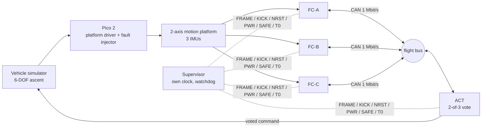

# Triplex Flight Computer

A desk-scale fault-tolerant flight computer: three redundant STM32 flight computers vote through a CAN bus to an actuator node, with real IMUs on a servo motion platform driven by a 6-DOF vehicle simulator. Faults are injected on purpose and measured.


**Status (19 Oct 2026):** everything that can be built and checked without the hardware is built and checked. The parts have arrived and **nothing has run on a board yet**: the timing, the real bus, the real IMUs and the detection times on hardware are the work that is left, and every hardware claim stays a target until a log exists. [`docs/STATUS.md`](docs/STATUS.md) says what is built, what is proven and what waits for the hardware; [`docs/LIMITATIONS.md`](docs/LIMITATIONS.md) says what is not claimed; [`docs/verification/FMECA.md`](docs/verification/FMECA.md) ranks what could go wrong.



## The evidence, in numbers

| | |
|---|---|
| Host tests under ASan and UBSan | <!--m:cpp_tests-->887<!--/m--> C++, <!--m:python_tests-->641<!--/m--> Python |
| Fault campaign | <!--m:campaign_scenarios-->12,362<!--/m--> scenarios, <!--m:campaign_frames_million-->4.9<!--/m--> million frames, no property violated |
| Fault coverage | <!--m:fault_kinds-->32<!--/m--> fault kinds, <!--m:fault_matrix_rows-->102<!--/m--> fault-matrix rows, <!--m:fmeca_rows-->102<!--/m--> failure modes in the [FMECA](docs/verification/FMECA.md) |
| Mutation testing | <!--m:mutants_unit-->470<!--/m--> deliberate bugs in the flight code and <!--m:mutants_sim-->494<!--/m--> simulator mutants; last full run: <!--m:mutation_unit_result-->not yet recorded<!--/m--> (core), <!--m:mutation_sim_result-->not yet recorded<!--/m--> (simulator) |
| Flight-code coverage | <!--m:coverage_core_line-->0<!--/m--> % of lines, <!--m:coverage_core_branch-->0<!--/m--> % of branches (`core/`, `supervisor/`) |
| Requirements and decisions | <!--m:requirements-->186<!--/m--> requirements, <!--m:adrs-->58<!--/m--> ADRs |
| On a board | nothing yet |

These come from `tools/docs/metrics.py`: computed from the repository, or recorded with the date of the run that made them. Each is explained, with its command, in [`docs/STATUS.md`](docs/STATUS.md) section 2.

## What is built

| Area | State |
|---|---|
| **Flight core** (`core/`, `supervisor/`; C++17, header-only, no heap, no exceptions): voter, fault manager, sensor/compute split, state resynchronisation, estimator, controller, actuator-node and supervisor logic | Built and tested on the host; reviewed by a second reader ([review](docs/verification/CODE_REVIEW_CORE.md)) |
| **Firmware** (Zephyr; `firmware/`): flight computer, actuator node, Pico, supervisor | Builds for `native_sim`, `nucleo_g474re`, `rpi_pico2`; live tests with real instances on a virtual CAN bus ([firmware/README.md](firmware/README.md)) |
| **Simulator and virtual peers** (`sim/`): a 6-DOF model that flies **any vehicle described in a file** ([VEHICLE_SPEC](docs/design/VEHICLE_SPEC.md)), platform model, fake FC-B and FC-C with 32 kinds of fault injection | Built ([sim/README.md](sim/README.md)) |
| **Flight console** and **3D viewer** (`console/`): one local web page for the launch sequence, the votes, the faults and their **measured** detection, every ground command; the flight seen as a vehicle ([CONSOLE](docs/design/CONSOLE.md), [VIEWER](docs/design/VIEWER.md)) | Built; exercised live on `vcan0`; the serial paths have not met a board |
| **Guidance, navigation and a whole mission**, with an **Euler flow solver** and real launch-site winds ([GNC](docs/design/GNC.md), [CFD](docs/design/CFD.md), [ENVIRONMENT](docs/design/ENVIRONMENT.md)): a Starship V3 class stack reaches orbit and its booster is caught by the tower, in a model built from public numbers and my estimates, not SpaceX data | Built and flown **on the host only**: no timing on the board, no mutants |
| **Analyses** ([hazards](docs/verification/HAZARDS.md), [FMECA](docs/verification/FMECA.md), [safety case](docs/verification/SAFETY_CASE.md), [risks](docs/verification/RISKS.md), [validation](docs/verification/VALIDATION.md)) | Written; the FMECA is checked by a tool against the fault matrix and the campaign |
| **Hardware** (the platform, the rig, the supervisor's board, the overrides) | Parts arrived 8 Oct 2026; procedures written ([docs/procedures/](docs/procedures/FIRST_HARDWARE_DAYS.md)) |

## Build, test, run

```bash
cmake -S . -B build -G Ninja -DTFC_SANITIZE=ON && cmake --build build && ctest --test-dir build --output-on-failure   # the C++ suite and the strict gates
(cd sim && python3 -m unittest discover -s tests -t .)                                                              # the Python suite
console/tfc-console                                                                                                  # the flight console (console/README.md)
```
The whole list, including the campaign, mutation testing and the live tests, is [`docs/STATUS.md`](docs/STATUS.md) section 9.

## CI
`.github/workflows/ci.yml` runs on pull requests and on `main`: the documentation checks (including that every number quoted is current and that the FMECA covers the fault matrix), the strict build, the sanitizer tests, clang-tidy, cppcheck, the coding-standard and coverage gates, the fault campaign (a sample on pull requests), the mission runs, the firmware builds and the live triplex test. `.github/workflows/mutation.yml` runs the mutation checks monthly and on demand.

## Contributing
GitHub Flow: `main` is always green, all work happens on short-lived branches and lands by squash-merged PR. See [CONTRIBUTING.md](CONTRIBUTING.md).

## Docs
Start at the index: **[docs/README.md](docs/README.md)**. The five-minute reading is [STATUS](docs/STATUS.md), [LIMITATIONS](docs/LIMITATIONS.md), [ARCHITECTURE](docs/design/ARCHITECTURE.md) and [PROOF](docs/project/PROOF.md); the decisions are in [DECISIONS](docs/decisions/DECISIONS.md).

SpaceX-related statements are from public material or inference, not insider knowledge. This is an educational project, not flight-qualified hardware.
