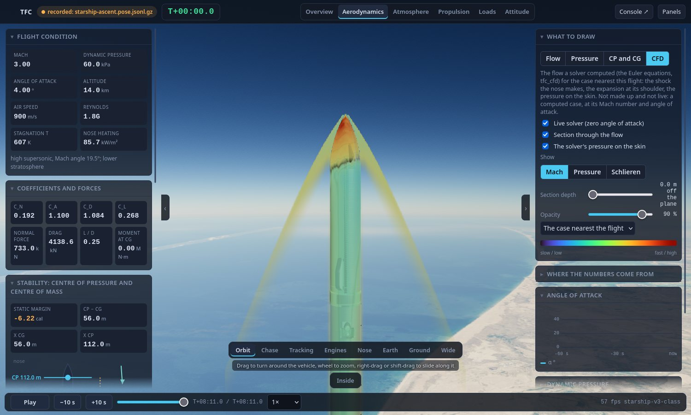
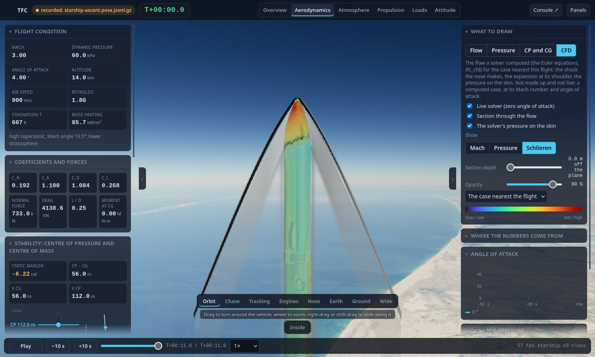

# CFD: an Euler flow solver for the vehicle's body

> Status: **built, validated on exact solutions, and run on the Starship-class body** (accepted 17 Oct 2026, ADR-050; extended 18 Oct 2026, ADR-051): `sim/cfd/` (the solver, header only), `tools/sim/tfc_cfd.cpp` (the tool), `tools/cfd/make_library.py` (a library of cases), `tests/test_cfd.cpp` (16 tests), `sim/tests/test_console_cfd.py` (the viewer's side), and the viewer's CFD view (`console/web/viewer/js/cfd.js`, the Aerodynamics lens). Round 2 (18 Oct 2026, ADR-051) added the real-gas equation of state (section 11), the flaps and grid fins as geometry (12), the boundary layer's friction and heating and the base (13), and **tables of the solver's coefficients that the simulator's flight flies on** (14, `aero.cfd`). The engineering build-up of `AERODYNAMICS.md` is still what flies where there is no table: below Mach 1.4, the flaps and fins, the turning of the body, and any vehicle without one.

## 1. What it is, and what "full CFD" is not here

Computational fluid dynamics is the numerical solution of the equations of the moving air round a body. The most complete form (the Reynolds-averaged Navier-Stokes equations with a turbulence model and the chemistry of the hot air in a hypersonic shock) is a research code and a cluster. This is the first rung of that ladder, and a real one: **the Euler equations**, which are the Navier-Stokes equations without viscosity and heat conduction, solved in **three dimensions** on the **real outline of the vehicle** (the sections of its file), for a **calorically perfect gas** (gamma 1.4).

It is the method of NASA's Cart3D, which was used for the Space Shuttle's and the SLS's aerodynamic databases: a Cartesian grid, the body cut out of it, shocks captured, pressure forces integrated. It is good at exactly what an inviscid solution is good at, and the Mach number range where it matters (supersonic and hypersonic: a shock stands off the nose, expands round the shoulder, and the pressure on the skin follows) is the range the engineering build-up of `AERODYNAMICS.md` handles worst.

| It gives | It does not give |
|---|---|
| the shocks and expansions, where they are and how strong | the boundary layer itself: the friction and the heating are added to it by a reference-temperature law (section 13), an estimate, not a viscous solution |
| the pressure on every part of the skin | separation, the wake, and so the **base pressure** (an Euler solution has no wake: the base drag is the build-up's law, the solver's number is kept apart and means little) |
| the force and moment from it: CA of the skin, CN, the centre of pressure | the vortices that roll up from a body at an angle of attack, and the forces they add |
| the flow field, for the viewer | chemistry that is not in equilibrium (the real gas of section 11 is air in equilibrium: right at the entry's densest, wrong where the air is thin), ionisation, radiation |
| any Mach number from about 2 up | transonic flow (Mach 0.8 to 1.3: the boundary layer decides where the shock sits) |
| flaps and grid fins as geometry (section 12) | converged flap forces: the solver's flaps are not grid-converged at the sizes that can be afforded (section 12) |

The rungs that were next in the first version (a viscous term, flaps and fins in the geometry, the real-gas equation of state) were taken in round 2 as far as an Euler solver can take them (sections 11 to 13); the rest of the ladder is a viscous solver with a turbulence model (separation, the wake, shock-boundary-layer interaction) and a mesh that follows the shocks.

## 2. The equations and the numerics

The unknowns in each cell of the grid are the density, the three components of the momentum and the total energy; `euler.hpp` and `solver.hpp` solve

    dU/dt + dF/dx + dG/dy + dH/dz = 0,    p = (gamma - 1) (E - rho |u|^2 / 2)

by the finite-volume method:

* **The grid** is a tensor product of three lines of cell faces (`graded_nodes`): cells of one size over the body and a little beyond it, growing by 10 % a cell up to four times that far from it, so that a body 124 m long and 9 m wide has about 350,000 cells at 0.6 m. The plane z = 0 is a plane of symmetry (the body is symmetric about it: the angle of attack is in the x-y plane), so the grid is half the vehicle.
* **The flux** across a face is HLLC (Toro): two waves and a contact, which keeps a contact and a shear sharp, with the wave speeds of Einfeldt from Roe averages; where the pressure differs by more than 1.8 times across the face (a shock lying along it) the flux is **HLL** instead, which has no contact and therefore cannot grow the carbuncle (a spurious bump on a bow shock that HLLC alone is known to make on a grid-aligned shock). Measured on the sphere (section 5) the choice moves the stagnation pressure by less than 1 %.
* **The reconstruction** to second order is MUSCL on the primitive variables (density, velocity, pressure) with the **van Albada** limiter (smooth, it does not flatten an extremum as the minmod does); a reconstruction that is not a physical state (a negative pressure or density) falls back to the cell's own value. Spacing-aware, so the grid may stretch.
* **The time** step is a two-stage Runge-Kutta (the strong-stability-preserving one of Heun) at a **local** step (each cell at its own CFL of 0.6) toward a steady state, or one global step for a time-accurate run (the shock tube). The density residual falls 2 to 4 orders in a few thousand iterations and stalls there (the limiter chatters in the shock); the forces stop moving long before, and the tool stops on that (the forces unchanged by 0.2 % over 500 iterations, after 1,000) or on a residual target.
* **The boundaries**: the free stream at the inflow, a characteristic (Riemann-invariant) far field where the flow can go either way (the sides, at an angle of attack), extrapolation at the outflow, and a mirror at the plane of symmetry.
* **Threads**: a persistent pool cuts each loop into equal planes, one part per thread; every plane writes only its own cells, so **the result is the same bit for bit whatever the number of threads** (a test: 1 and 5).

Speed, measured: 0.41 microseconds per cell per iteration on one core (an optimised build; the unit tests run 6 to 8 times slower, with the sanitisers), 6 ms an iteration for 51,000 cells on twelve threads. The Starship body at Mach 3 and 4 degrees: 95,000 cells 14 s, 177,000 cells 36 s, 353,000 cells 81 s, 735,000 cells 152 s.

## 3. The body

The body is **a signed distance** (`shape.hpp`): a function that is negative inside and positive outside, and the distance to the surface at either side. `Revolution` makes it from the outline of the vehicle (`vehicle_body.hpp`: the radius at stations along the sections of the stages, a nose with its stations crowded at the tip, the same outline the viewer draws); `Sphere`, `HalfSpace`, `Box`, `Union` and `Intersection` are there for the checks and for what comes next.

A cell whose centre is inside is **solid**. A solid cell within two cells of a fluid one along an axis is a **ghost cell** (the second-order stencil reaches two cells): at each stage it takes the state of the fluid at its **image point**, the point mirrored in the surface, with the velocity's component along the normal reversed, so that on average no air goes through the surface. That is the slip wall of the Euler equations (the **ghost-cell immersed boundary** of Tseng and Ferziger). It needs no mesh of the body, and a body of any shape is one function; the price is that the wall is not aligned with the grid, so a stagnation point is the weak case (section 5).

**The forces** are read at the surface elements of the shape (a patch of the skin with its place, its outward normal and its area): the pressure at 0.5 and 1 cell off the surface along the normal, extrapolated linearly to the surface (`probe_extrapolate`). The reason is in the data: behind a cone's shock the pressure falls with the distance from the wall (it is real: the flow is isentropic along the streamline and the Mach number rises toward the shock), so a single reading at 1.5 cells read 2 to 7 % low on the cone; read at 0.5 and 1 cell and extrapolated, the error is under 1 % at every resolution tried. The force is the gauge pressure (over the free stream's) times the normal and the area, over the half body and its mirror image.

**Frames**: the body's axis is x from the tail (the vehicle file's x) with the nose at the largest x; the air moves toward -x at the Mach number, tilted by the angle of attack in the x-y plane (the velocity of the vehicle through the air is +x and +y: the side it moves toward, y > 0, is the windward one). CA is positive for drag (`-F_x / q S`), CN positive toward the side the flow comes from (`-F_y / q S`), the reference area is that of the largest diameter (or `aero.reference_diameter_m`), and the **centre of pressure** is where the moment about a reference point says one force would have to act: `x_cp = x_ref + M_z / F_y`, which includes the moment of the axial force (the usual definition from a moment coefficient).

## 4. Running it

    build/host/tfc_cfd --validate [--quick]                                   # the solver against the exact solutions: section 5
    build/host/tfc_cfd vehicles/starship.json --mach 3 --alpha 4 --h 0.6      # one flow: CA, CN, CN-alpha, the centre of pressure
    build/host/tfc_cfd vehicles/starship.json --machs 2,3,5 --alpha 4 --table cfd_table.json   # a table in the form of aero.table
    build/host/tfc_cfd vehicles/starship.json --mach 3 --alpha 4 --field console/cfd/starship/m3_a4.cfd   # the flow for the viewer
    python3 tools/cfd/make_library.py vehicles/starship.json                  # Mach 2, 3, 5, 8, 12 at 0, 4 and 10 degrees

`--h` is the cell over the body (default a sixth of its radius: **use 8 or more cells across the radius for a number you will quote**, section 6), `--stage-from K` takes the body of the stages from K on (the ship alone: 1), `--probe` chooses how the surface pressure is read, `--xref` the point the moment is about. A case takes 30 to 150 seconds on twelve cores.

## 5. Checked against exact solutions

`tfc_cfd --validate` (589 s on twelve cores for the whole set; `--quick`, 85 s, leaves out the finer grids and the sphere) runs each case on several grids and prints the error against the exact answer, which comes from `gasdyn.hpp`, written without any of the solver's code: the Rankine-Hugoniot normal shock, the oblique shock (theta-beta-Mach), Rayleigh's pitot formula, the **Taylor-Maccoll** equation for the flow over a cone (integrated with a Runge-Kutta from the shock to the surface), and Toro's exact solution of the Riemann problem. Measured, 17 Oct 2026:

| Case | Quantity | Grid | Error |
|---|---|---|---|
| Sod's shock tube (time-accurate, 1D in the 3D code) | L1 error of the density at t = 0.2 | 100, 200, 400 cells | 0.0062, 0.0033, 0.0018 (first order at the discontinuities, as it should be) |
| Wedge of 10 degrees, Mach 2 | pressure behind the shock | 40 x 17, 80 x 34, 160 x 68 | 0.02 %, 0.00 %, 0.00 % |
| | shock angle (39.31 degrees) | the same | 0.96 %, 0.10 %, 0.10 % |
| Cone of 15 degrees, Mach 2.5 | surface pressure (1.805 x free stream) | 5.4, 7.7, 10.7 cells across the base radius | 0.76 %, 0.54 %, 0.60 % |
| | shock angle (28.45 degrees) | the same | 2.2 %, 1.6 %, 1.6 % |
| Cone of 10 degrees, Mach 5 | surface pressure (2.308 x free stream) | 9.9, 14.1 cells | 1.9 %, 1.5 % |
| | shock angle (15.61 degrees) | the same | 0.8 %, 0.5 % |
| Sphere, Mach 3 | pressure at the stagnation point, read within 6 degrees of the axis (12.06 x free stream, Rayleigh) | 10, 14 cells across the radius | **-8.9 %, -3.1 %** |
| | shock stand-off (Billig's correlation, 0.205 radii) | 10, 14 cells | +17 %, +12 % (one cell is 10 % and 7 % of a radius) |

What this says: a smooth, slender body (a cone, a wedge, the ogive of a launcher) is right to about 1 % in pressure at 8 or more cells across its radius; **a blunt nose is not**: an immersed boundary reflects the flow about a wall that does not lie along the grid, and at a stagnation point that costs 9 % at 10 cells and 3 % at 14 (it falls fast with the grid). The flux and the limiter hardly matter there (HLL against HLLC, a switch at 1.8 or never: 11.36 to 11.42 at 10 cells; the Van Leer limiter 11.6). The Mach 5 cone's error is larger than the Mach 2.5 one's and falls slowly with the grid because the shock is thin and close to the surface there.

The nine unit tests (`tests/test_cfd.cpp`, 10 s with the sanitisers) check the relations against their textbook numbers, a uniform stream staying uniform to 1e-12, Sod's tube, the wedge, a cone on a coarse grid (a smoke test: the number is in the table above), a body in still air leaving it still (1e-9), the surface elements adding up to the areas of the shapes (a sphere, a cone) and their normals pointing out, a constant pressure making no force on a closed body, and the result not depending on the number of threads.

## 6. On the vehicle: the Starship-class body, Mach 3, 4 degrees

Grid study (`tfc_cfd vehicles/starship.json --mach 3 --alpha 4`, the whole stack, 124.4 m long, 9 m wide, the moment about 40 % of the length):

| Cell over the body | Cells | Cells across the radius | CA (skin) | CN-alpha (per rad) | Centre of pressure from the tail | Time |
|---|---|---|---|---|---|---|
| 1.0 m | 95,000 | 4.5 | 0.204 | 3.05 | 111.2 m | 14 s |
| 0.8 m | 177,000 | 5.6 | 0.212 | 2.94 | 113.8 m | 36 s |
| 0.6 m | 353,000 | 7.5 | 0.206 | 2.90 | 113.8 m | 81 s |
| 0.45 m | 735,000 | 10.0 | 0.211 | 2.90 | 116.1 m | 152 s |

CN-alpha is settled to about 1 % from 7.5 cells across the radius; the centre of pressure moves by a metre or two (it is a small moment over a small force: 1.8 % of the length); CA varies by 2 % between grids, as the steps of the interstage (a forward-facing step is the weak case of an immersed boundary) are resolved better or worse. The simulator's engineering build-up, for the same body, has CN-alpha **2.0** and the centre of pressure at **116.9 m** at every Mach number (`aero_summary`; the full-regime model of section 7 of `AERODYNAMICS.md` changes the body's force above Mach 3 but is not on for this vehicle).

**Over Mach number and angle of attack** (`tools/cfd/make_library.py`, 0.7 m cells, 7 cells across the radius, 246,000 cells, 30 to 70 s a case; CN-alpha and the centre of pressure from the 4-degree case, CA from the case at no angle of attack; the build-up from `aero_summary`):

| Mach | CA skin, CFD | CA, build-up | CN-alpha, CFD (per rad) | CN-alpha, build-up | x_cp, CFD (m from the tail) | x_cp, build-up |
|---|---|---|---|---|---|---|
| 2 | 0.228 | 0.344 | 2.61 | 2.00 | 115.7 | 116.9 |
| 3 | 0.204 | 0.272 | 2.97 | 2.00 | 113.7 | 116.9 |
| 5 | 0.176 | 0.199 | 3.69 | 2.00 | 97.2 | 116.9 |
| 8 | 0.156 | 0.152 | 3.74 | 2.00 | 88.8 | 116.9 |
| 12 | 0.146 | 0.126 | 3.37 | 2.00 | 90.1 | 116.9 |

What the two models say, then. The **CFD's normal-force slope is 1.3 to 1.9 times the build-up's** (the build-up's 2.0 is slender-body theory for a body with a cylinder and a nose: it does not grow with the Mach number), and its **centre of pressure moves 20 to 30 m forward at hypersonic speed** (the build-up keeps 116.9 m at every Mach number): the centre of pressure is within a calibre of the nose at Mach 2 and 3 and well down the body from Mach 5. The CFD's **axial force is lower** at Mach 2 to 5 (skin only: the friction and the base, which an Euler solution does not have, are in the build-up's number, and at Mach 3 the base alone in this solution is +0.06 to +0.09 depending on the grid, which it should not be trusted for) and about the same or higher above Mach 8. Which is nearer the real vehicle cannot be said from here: neither is a measurement of the real vehicle, whose outline in the file is estimated, and the Euler solution has no viscosity (the flow separates from the real body where it does not from this one).

The force is **not linear in the angle**: CN at 10 degrees is 0.555 at Mach 2 but 1.02 at Mach 3 (CN/alpha 3.2 and 5.9 per radian), 1.14, 0.97 and 0.85 at Mach 5, 8 and 12, and the centre of pressure at 10 degrees is 72 to 83 m for Mach 3 and above (the lift is spread over the whole body: a crossflow). The cross-flow Mach number is M sin(alpha): 0.35 at Mach 2 and 0.52 at Mach 3, and a cylinder's flow in a cross-stream goes sonic on its shoulder at about 0.4, so what jumps between Mach 2 and 3 is probably the crossflow's wave drag (a physical effect of this inviscid flow), and not a defect; it is **not** a check, and a CN-alpha from the 4-degree case is a slope at 4 degrees.

## 7. The flow for the viewer (the CFD view)

`tfc_cfd --field FILE` writes one file for the 3D viewer: a JSON line (the case, the coefficients, the body's outline, the grids), the pressure coefficient on the skin on a grid of stations along the outline and angles round it (0 to 180 degrees, the mirror half is not stored), and a box round the body of three 16-bit volumes (pressure ratio and density ratio on logarithmic scales, the Mach number; 0 means inside the body), 0.4 body radii beyond the nose and the tail and 2.6 radii to each side. About 0.7 MB a case for the Starship (the two committed in `console/demo/` are Mach 3 and Mach 8 at 4 degrees). The layout is checked by `sim/tests/test_console_cfd.py` against what the solver wrote (the numbers start on a multiple of four bytes: the browser views them as `Float32Array` and `Uint16Array`).

The console serves them from `console/cfd/` (the library, not in the repository: `console/cfd/README.md`) and `console/demo/` (the few that are), as `/api/viewer/cfd` (the list, read from each file's header) and `/api/viewer/cfd/file?name=` (a name from the list only).

The **CFD** view of the Aerodynamics lens (key 2, then *CFD*) picks the case nearest the flight's Mach number (in its logarithm) and angle of attack, or the one you choose, and draws:

* **a section through the flow** in the plane of the vehicle's angle of attack (turned to the flight's own plane, as the angle of attack is in a plane that rolls), as the **Mach number**, the **pressure** over the free stream's (a tenth to a hundred, logarithmic) or a **schlieren** picture (the gradient of the density, which is what a shadowgraph shows: shocks light, expansions dark). The undisturbed air is left clear, so that what you see is the disturbance. A slider moves the section off the plane of symmetry (z in cells).
* **the solver's pressure on the skin**, in the colours of the Pressure view, in place of the Newtonian estimate (the shader looks it up by the body's length and the angle round it from the windward side).
* a card, **What the solver says**: the case's Mach number, angle of attack and grid; CA, CN, CN-alpha and the centre of pressure, beside the **build-up's** CN-alpha and centre of pressure at the present moment of the flight, so that the two models can be compared on the same screen.

The section drawn here is the live solver's (section 10); a computed case is **not live**: it is at its own Mach number and angle of attack, labelled with both and with the flight's; nothing is interpolated between cases. The live solver (next section) is the part that moves.

## 8. The first question: does the flight survive the solver's aerodynamics? (17 Oct 2026, before the tables fed it)

In the first version nothing fed the flight; section 14 is what does now. This section is the experiment that was done instead, and it stays because it measures something section 14 does not: the flight's *margin* to a plant that differs from the one it was designed for. The flight's forces then are those of the engineering build-up (`AERODYNAMICS.md`), and the plant's `aero.table` (a table of CA, CN-alpha and the centre of pressure by Mach number) is **used only when a vehicle has no sections**: a table made by `tfc_cfd --table` is in the right form, but it cannot replace the build-up for a vehicle that flips and enters at large angles, since the table is linear in the angle and the build-up's cross-flow is what flies the booster's flip and the ship's belly entry.

What was done instead is a **measured question**: *does the flight survive the aerodynamics the solver gives?* The build-up's normal-force slope is scaled in the mission file (`"vehicle": {"cn_scale": X}`, the `vehicle.cn_scale` knob) and `tfc_mission vehicles/missions/starship_return.json --pad 1500 --seed N` flies the whole mission (the flight computers, the booster's boost-back, entry and catch, the ship to orbit) over 40 GNSS-noise seeds, 17 Oct 2026:

| CN-alpha of the plant | Ship's orbit (perigee over the seeds) | Booster caught by the tower |
|---|---|---|
| 1.0 x (the design) | 221 to 243 km | **40 of 40** (median miss 0.8 m) |
| 1.5 x (the solver at Mach 3 is 1.5 x) | 224 to 243 km | **4 of 40** (median miss 2.1 m, worst 4.5 m) |
| 1.9 x (the solver at Mach 5 to 8) | 224 to 244 km | **9 of 40** (median miss 3.0 m, worst 4.7 m) |

(and, seed 0 only, 1.3 x and 2.5 x: the orbit is 233 to 238 km perigee, the booster misses by 2.0 and 1.8 m.) So: **the climb and the orbit are robust to a plant whose normal force is 2.5 times what the design assumed** (the controller is already holding a vehicle that is 6 calibres unstable), **and the booster's catch is not**: the controller lands the stage 2 to 4 m from the tower's arms, which close at 1.5 m, once the air turns the stage more strongly than its plan thinks. Nothing here says the real stage does that: the solver is inviscid and the outline is an estimate. It says where the margin of this design is, which is the catch and not the ascent, and that a better model of the aerodynamics (this one) is worth a plan that tolerates one (`RECOVERY.md`'s owed list: a plan robust to the separation state is the other).

## 9. What is not done

* **The solver's flaps and fins in the flight.** They are in the tool (section 12) and their forces are not converged; the plant's plates fly (section 14).
* **A viscous solver**, a turbulence model, separation and the wake: the base drag is the build-up's law, the friction an integral law (section 13). Shock-boundary-layer interaction, the lee-side vortices of a body at a large angle of attack, and the blunt nose's heating are not modelled.
* **Finite-rate chemistry** (the real gas is in equilibrium, section 11), ionisation, radiation.
* **Transonic flow** (Mach 0.8 to 1.3) and everything below Mach 1.4 in the tables (the build-up flies there).
* **A grid that refines itself where a shock is** (the 4 times coarser far field is fixed); the 0.7 m grid of the tables has 6 to 7 cells across the radius.
* **The entry guidance for the solver's aerodynamics** (the ship's return is tuned to the build-up's, section 14), and tables for the vehicle with its flaps in the stream.
* **Mutation testing** of `sim/cfd` (the unit tests and `--validate` are the checks) and the live solver's angle of attack (it is axisymmetric) and skin pressure.

## 10. The live solver (`console/web/viewer/js/gpuflow.js`)

The same scheme in two dimensions, on the graphics card, as WebGL2 fragment shaders: the **axisymmetric Euler equations** in the plane of the axis and the radius, `d(rU)/dt + d(rF)/dx + d(rG)/dr = (0, 0, p, 0)`, on a uniform grid (about 640 x 160 cells for the Starship: 0.23 m, 20 cells across the radius), with the state in four float textures (`EXT_color_buffer_float`). Each iteration is four passes: fill the ghost cells (the image point is found by four fluid-only bilinear weights; the velocity's normal component is reversed), advance one stage; again. The flux is HLLC with HLL on a strong shock, the reconstruction MUSCL with van Albada's limiter, the step local (a steady state), the axis a mirror, the inflow the free stream at the Mach number of the flight: a copy of `euler.hpp` and `solver.hpp` in GLSL, with the cylindrical source. The body is the outline of the stages on the vehicle (rebuilt when one leaves), cut out of the grid by a signed distance computed on the page.

* **It is checked on the page** (`viewer/gputest.html?token=...`, the cone of section 5, where an axisymmetric solver is exactly the Taylor-Maccoll problem; the numbers go to the console server's log). Measured on this machine (a GTX 1660 Super, headless Firefox), 233 x 100 cells, 3,000 iterations in 0.26 s (about 11,000 iterations a second at 23,000 cells): Mach 2.5, 15 degrees: surface pressure **1.797** against 1.805 (-0.4 %), shock angle 28.29 against 28.45 degrees; Mach 5, 10 degrees: **2.265** against 2.308 (-1.9 %), shock 15.62 against 15.61 degrees. The same errors as the 3D solver's on the same cones, from a different code.
* **It follows the flight**: the Mach number is set from the pose (above 1.25; below it, or where the air is thinner than the vehicle is wide, the case of the library is shown instead), a change of more than 50 % starts from the free stream, a smaller one continues from the flow it has. The flow settles in 1,000 to 3,000 iterations, a fraction of a second to a second at 60 frames a second (the iterations a frame are adjusted to the frame time, 8 to 120). It draws as the same section (Mach, pressure, schlieren), turned to the plane of the flight's angle of attack, with the radius both ways.
* **What it is not**: it has **no angle of attack** (the flow of a body of revolution at an angle is three-dimensional; the computed case has it, and the section says which it shows), it is inviscid, and it computes the section only: the pressure on the skin in the CFD view is the library's. It does not feed the flight.
* **Tests**: `selftest.js` goes through the four views of the Aerodynamics lens, and with a supersonic pose checks that the live solver has run, that its state is finite and its density positive everywhere, that a flow field loaded and that the solver card has numbers (72 of 72 checks on the recorded flight, 67 of 71 on a synthetic pose, the four that fail being those of a pose with no tanks and no booster).

## 11. The real gas (`sim/cfd/eos.hpp`)

Behind the bow shock of a body at Mach 12 the air is not a gas of gamma 1.4. At 52 km, Mach 12 would raise a perfect gas to nearly 8,000 K; the molecules of oxygen and nitrogen soak up energy in their vibration and then break apart, so the real temperature is lower, the density higher and the shock closer to the body. The solver's equation of state is therefore a table-driven one, `RealAir`, with the *ideal dissociating gas* of Lighthill and Freeman: a mixture of molecules and atoms in **equilibrium**,

    p = rho R T (1 + alpha),    e = (1 - alpha) R (5/2 T + theta_v / (exp(theta_v / T) - 1)) + alpha R (3 T + theta_d),
    alpha^2 / (1 - alpha) = (rho_d / rho) exp(-theta_d / T)

with a characteristic temperature of vibration `theta_v` = 3,000 K, of dissociation `theta_d` = 59,500 K and a characteristic density `rho_d` = 150,000 kg/m^3 (the constants of the air as the Lighthill-Freeman model is usually fitted to it). `alpha` is the dissociated fraction. Cold, `alpha` is 0, the vibration is out and the gas is a perfect one of gamma 1.4 (to 1e-4). It is one fluid, not a mixture of species: it has no nitrogen oxides, no ionisation, no finite rate of reaction and no radiation.

* **The solver reads it through `Gas`** (`e_from_p`, `p_from_e`, `sound`, `gamma_eff`): the primitive variables, the flux (the Roe average uses the effective gamma `1 + p / (rho e)` of the two sides, the HLLC speeds the equilibrium speed of sound), the pressure floor. A perfect gas is the same object with no table, so the perfect-gas solver is the real-gas solver with the table off, and the checks of section 5 pass as before.
* **The tables** are 500 points in ln rho (from 1e-3 to 100 times the free stream's density) by 1,400 in ln e or ln p, made without a Newton solve: for each density the pressure and energy are computed along a fine grid of temperatures and the table is the grid interpolated backwards. Against the equations they come from: **2.4e-4** in the worst of 20 test states (an earlier, coarser table was 2.4e-3). Outside them the equations are solved exactly.
* **The temperature solve is a safeguarded Newton.** One bug was found by flying it: at 68 km and Mach 20 the wake behind the base is a thousandth of the free stream's density, where the dissociation sets in over a few per cent of the temperature, and Newton's method alone jumped from one shoulder of the dissociation to the other and back, shrinking its bracket by a percent a step; after 80 steps it returned a temperature that was no root, the sound speed squared came out at -1,200 and the run was lost. The solve now bisects whenever Newton's step does not at least halve the previous one (`cfd_the_temperature_solve_finds_a_root_in_the_thin_dissociating_gas_of_a_wake` fails on the old solve). Two cases of the tables made before the fix (Mach 12 at 50 degrees, Mach 8 at 20) were re-run after it: the same to five digits in CA, CN and Cm (the bad states were in the wake, not on the body), so the tables were not regenerated.
* **Where it applies.** The free stream's state (the temperature and density that make the characteristic temperatures non-dimensional) is that of the standard atmosphere at the altitude of the case (`--altitude`). `tools/cfd/make_aerodb.py` runs the perfect gas to Mach 5 and the real gas from Mach 8 at 42, 52 and 68 km for Mach 8, 12 and 20, an assumed lifting-entry corridor (`REAL_GAS_ALTITUDE_KM`), which is a statement of that script and not a trajectory of the plan. The equilibrium assumption is the entry's at its densest and wrong where the air is thin (the chemistry freezes): at Mach 20 and 68 km the Euler solution is a model of the shock layer's inner part and not a prediction.

**Checked** (`tfc_cfd --validate --only gas`, section 5 of the output): a gas thrown at a wall at Mach 5 and 10 at 40 km makes a shock whose state behind it is that of the steady normal shock of the equation of state, solved from the conservation laws in `gasdyn.hpp` (`real_normal_shock`, mass, momentum and energy to 1e-9): the pressure to **0.00 %**, the density to 1.5 % (Mach 5) and 0.7 % (Mach 10), the temperature to 1.5 and 0.3 %. A Mach 15 shock has a density ratio more than 1.8 times the perfect gas's, a temperature less than half of it and more than 10 % dissociated (a unit test). A sphere at Mach 20 in the real gas is checked against the exact real-gas stagnation pressure to within 10 % (the weak case of an immersed boundary: the shock's stand-off is under two cells and is not checked): perfect gas **4.0 %** low, real gas **8.9 %** low, and the two solutions differ by 0.2 % where the exact ones differ by 5.5 % (543.9 against 515.5): at this grid the shock layer is too thin for the solver to see the real gas's effect on the stagnation pressure, and the real-gas sphere is the weakest check of the 8.

## 12. Flaps and grid fins (`sim/cfd/vehicle_surfaces.hpp`)

The body alone is not the vehicle. The ship's four flaps and the booster's grid fins are in the vehicle file as surfaces (position, area, chord, span, deflection), and the solver takes them from there, at the deflection each is at.

* **A flap** hinged along the axis (Starship's: `axial_hinge`) is a plate, `BeveledPlate` in `shape.hpp`: the `span` along the axis from its hinge, the `chord` out from it in the direction the plant's own frame gives for the deflection (0 lying on the skin, 90 standing straight out), pointed at both ends over three thicknesses, so that a Mach 3 stream does not meet a flat face and stand a detached shock in front of it (the plate is cut out of the grid like the body; its surface elements are numbered 10 + its index in the file, so that the force on it can be reported apart). The thickness is not in the file: `--flap-thickness` (1.2 m by default; the viewer's models are about 1.4 m) and it must be about three cells.
* **A grid fin** is a lattice of webs a few centimetres apart: no grid can hold it, so it is a **porous box** (`Porous` in `solver.hpp`) with the fin's frame, a depth along its cells and a momentum sink `-rho |u| (k_axial u_axial + k_cross u_cross) / depth` (the air going along the cells loses 0.3 dynamic pressures over the depth, the air going across them 20: the webs stop it), applied implicitly and conserving the total energy (the kinetic energy it takes is heat). A lattice at an angle to the stream turns it toward its axis, and the stream pushes on the lattice with a force that is read as the momentum taken. A fin that is folded is not there.
* **`--surfaces stowed|deployed`** puts them on the body of `tfc_cfd`, `--deflect NAME=DEG,...` moves the named ones, and the output has the force of each flap (with its mirror image) and of each lattice: its CA, CN and the moment.

**Checked**: a pointed plate (a diamond of half-angle 10 degrees at Mach 3 and 4 degrees) has on its windward face the pressure the oblique shock gives to within 12 % at the unit test's cell of 0.15 (6.5 % low at 0.12 and 4.4 % at 0.08 in longer runs) and on the gentler leeward face to within 20 % (3 % at 0.12 and 0.5 % at 0.08): the pointed edge is the immersed boundary's hard case; a lattice at 10 degrees in a Mach 2 stream turns it toward its axis, pushed back and away from the side the cells lean toward, with a normal force 15 % off the ideal straightener's `2 sin cos` on the frame (0.39 against 0.34; the test's band is 25 %).

**What it says about the plant's flap model, and why it is not used.** The plant's flaps are plates of the engineering build-up (`surfaces.hpp`: a lift slope of the plate's aspect ratio, a stall, a cross-flow drag; the stream along the hinge is edge-on and carries only friction). The flow solver can be asked the same question (`tfc_cfd vehicles/starship.json --mach 3 --alpha 4 --stage-from 1 --surfaces deployed`, the flaps at 60 degrees, the ship alone), and the two disagree by a large factor that does not settle:

| | the plate model | the solver, 1.0 m cells, 1.2 m flaps | the solver, 0.5 m cells, 1.5 m flaps |
|---|---|---|---|
| aft flaps (both) CN | 0.005 | 0.044 | **0.092** |
| aft flaps Cm | 0.009 | 0.074 | 0.151 |
| forward flaps CN | 0.001 | 0.007 | 0.009 |

The solver's flap forces are **not converged** at the grids that can be afforded (they double when the cell halves), and the plate model is an order of magnitude below even the coarse one. A flap standing out of the skin at 60 degrees sits in the body's own compressed layer, where the cross-flow is not the free stream's, and the pressure on a thin plate's two faces is a small difference of large numbers; an immersed boundary a cell or two thick does not resolve it. So the solver's flaps are **in the tool and not in the tables**: the aero.cfd tables are the body alone, and the plant adds the flaps and fins from its own plate model, as before. A table of flap and fin increments from the solver (a finer grid, a body-fitted one, or an adaptive one) is the next step, and the disagreement above is the reason it is worth taking.

## 13. The boundary layer: friction and heating (`sim/cfd/viscous.hpp`)

An Euler solution has no skin friction and no heating. What it has at the wall (the pressure, the temperature, the speed of the air just outside the boundary layer, the layer's *edge*) is what a boundary-layer calculation needs, and the layer is computed from it by the **reference-temperature method** of Eckert on the flat-plate laws: the incompressible friction law is used at the density and the viscosity (Sutherland's law) of the air at a temperature between the edge's, the wall's and the recovery temperature (that of an insulated wall); the Reynolds analogy turns friction into heat.

* The **laminar** law is Blasius's, `0.664 / sqrt(Re_x)`; the **turbulent** one is Schultz-Grunow's local law, `0.370 / log10(Re_x)^2.584`; the turbulent reference temperature is Meador and Smart's. A laminar layer turns turbulent over a stretch: the intermittency rises as a smooth step from 0 at the transition Reynolds number (1e6 on the running length, `--transition`) to 1 at three times it.
* On a body of revolution the laminar length is **Mangler's**: the integral of `r^2 ds` over `r^2` (a cone: a third of the length, so that its friction is `sqrt(3)` times a flat plate's; a cylinder: the plate's).
* The wall is in **radiative equilibrium** (`--emissivity`, default 0.85): the heat that the layer brings is radiated away, so that the wall temperature is the one at which `sigma epsilon T^4` equals it (`--wall-temp` gives a fixed one).
* The panels are walked **along the outline from the nose**, with the edge state read from the solution at the surface (the pressure and the speed tangent to the skin), and the totals are CA from friction (with the wetted area), CN from the friction on a body at an angle, the heating flux, its peak and the wall temperature. Only the panels of the skin (part 0) are in it.

**Checked** (`tfc_cfd --validate --only viscous`, section 6, and a unit test) against the **exact laminar similarity solution** of the compressible boundary layer (the Levy-Lees equations solved as a boundary-value problem in `gasdyn.hpp`) and **Van Driest's second method** for a turbulent plate:

| | The layer | Exact | Error |
|---|---|---|---|
| Mach 0.01, laminar: `Cf sqrt(Re_x)` | 0.66400 | 0.66411 (Blasius's 0.664) | 0.02 % |
| Mach 2 insulated laminar plate | 0.63586 | 0.63787 | 0.32 % |
| Mach 5 insulated laminar plate | 0.53768 | 0.54735 | 1.77 % |
| Mach 2 turbulent plate, 100 m: average `Cf` | 0.00164 | 0.00161 (Van Driest II) | 1.4 % |
| Mach 5 turbulent plate | 0.00069 | 0.00065 | 5.8 % |
| Mach 8 turbulent plate | 0.00036 | 0.00033 | 10.5 % |
| cone: Mangler's length at 2/3 of the way | 0.66667 | 0.66667 | 0.00 % |

The turbulent number is the method's honest band (10 % at Mach 8: a reference-temperature law against a theory), and the tool says which panels it is not good for: it is an integral method on a flat-plate law, right to a few percent on a slender body at a small angle of attack and an *estimate* wherever the flow is not a developing boundary layer along a streamline: the blunt nose, the cross-flow of a body at a large angle, separation, and the interaction of a shock with the layer. It has no wake, no roughness and no ablation.

**What it gives on the ship** (`tfc_cfd vehicles/starship.json --mach 12 --alpha 40 --stage-from 1 --gas real --altitude 52 --viscous`, 123,000 cells): the friction adds **CA 0.056** to the pressure's 0.352 (and a CN of 0.010), the layer is 73 % laminar, the highest heating flux off the nose is **196 kW/m^2**, 58.5 MW goes into the whole skin and the wall reaches **1,420 K** at most and 813 K on average in radiative equilibrium. These are estimates of a model of a model, and the peak is where the layer is least good (the blunt nose); they are not the entry's thermal protection design.

**The base.** An Euler solution has no wake, so the pressure on a flat base is whatever the corner's expansion happens to leave (the Euler solution's own CA of the base is +0.0012 to +0.0026 at Mach 20 on a grid of 1.4 to 0.7 m: nothing). The tool therefore takes the base's drag from the build-up's own law (`aero.hpp`: `0.12 + 0.13 M^2` below Mach 1, `0.25 / M` above, less with the engines running: `--power`) on the area of the aft-facing flat end, and keeps the Euler solution's number apart (`ca_base_euler`) for the case where the base faces the stream. The solver's number is *not* the base drag; it is a diagnostic.

## 14. The flight uses it: the tables in the plant (`aero.cfd`)

Until now the solver was a second opinion (section 8 of the first version: nothing fed the flight). It now feeds it. A vehicle file can carry, in `aero.cfd`, **tables of the body's aerodynamic coefficients from the flow solver, one for each configuration of the vehicle**: the whole stack (stages 0 and 1), the ship alone (1), the booster alone (0). `Vehicle6` picks the table of the stages that are on the vehicle now, and with one the body's force and moment are the table's; without one (a vehicle with no table, or a configuration that has none) the engineering build-up of `AERODYNAMICS.md` flies, exactly as before.

**The table** (`CfdAeroDb` in `spec.hpp`, read and written by `spec_io.hpp`, validated at load): the Mach numbers (2, 3, 5, 8, 12, 20) by the angles of attack (0, 4, 10, 20, 35, 50, 70, 90, 110, 135, 160, 180 degrees), and for each pair `ca` (the pressure on the skin: friction and base are not in it), `ca_base` (the Euler solution's own force on the flat ends, which matters only with the base to the stream), `cn`, `cm` (the moment about `x_ref`, over the dynamic pressure, the reference area and the reference diameter), and for a body with a flat *forward* end (the booster without the ship) `ca_fore` and `cm_fore`: the windward face, kept apart (section 6 below). `tools/cfd/make_aerodb.py` makes them: it runs `tfc_cfd` over the 72 cases of a configuration (0.7 m cells, 6.4 cells across the radius, 120,000 to 160,000 cells; the perfect gas to Mach 5 and the real gas at the altitude of a lifting entry from Mach 8, section 11), caches each case in `build/aerodb-cache`, and writes `vehicles/aerodb/starship_{stack,ship,booster}.json`; a configuration takes 20 to 65 minutes on twelve cores. `tools/vehicle/gen_starship_return.py` inlines them into the generated vehicle files (`--no-aerodb` leaves them out).

**What the plant does with it** (`Vehicle6::shape_forces_cfd`, `sim/vehicle/cfd_aero.hpp`):

* The table is read by **bilinear interpolation in the Mach number and in the angle** (held at the ends: above Mach 20 the Mach 20 numbers), the angle being the angle between the body's axis and the velocity through the air, 0 to 180. The conventions are the build-up's (CN opposes the lateral velocity; the moment is about the centre of mass, from the table's about `x_ref` by the normal force and its arm), so that the controllers, which were designed against the build-up's, see the same signs.
* **Friction and base are the plant's, not the table's.** The skin friction is the viscous layer of section 13 on the free stream's state (the mean coefficient over the body's length, the wall at 80 % of the recovery temperature up to 1,500 K, the wetted area, times the cosine of the angle); the base drag is the build-up's law on the base's area, less with the engines running, until the angle passes 80 degrees, and then the solver's own pressure on the flat ends (`ca_base`), by a smooth step to 100 degrees. A flat forward end (`ca_fore`) acts, up to the same angles, as a drag on the windward face.
* **Below the table's lowest Mach number the build-up fades in**: the table is used whole from Mach 2, the build-up alone below Mach 1.4, a smooth step between. Transonic flow (Mach 0.8 to 1.3) is the build-up's, as before: an Euler solution is not good there.
* The **turning** of the body (the damping a body feels when it rotates, from its fins and its length) stays the build-up's, added to the table's force; the **flaps and grid fins** stay the build-up's plates (section 12). `cn_scale` and `cd_scale` of the plant multiply the table's force and moment, as they did the build-up's.
* **The design tools follow**: `Vehicle6::divergence()` (the aerodynamic instability the controllers are tuned against) and `aero_summary()` (CN-alpha, the centre of pressure and CA that the gain tables and `vehicle_model` read) use the table's slope at its first angle (4 degrees), faded with the build-up's below Mach 2.
* **A stage flown on its own** (`stage_alone`: the booster after hot staging is a vehicle of its own) takes the table of that stage alone, renumbered as the first stage of the vehicle it now is. **This was a bug in the first version of the integration**, found by flying it: the table was chosen by the stages the vehicle *has*, so the stack's table (for stages 0 and 1) also fitted the booster alone (which has stage 0), and the booster flew the stack's aerodynamics; removing all the booster's drag and normal force from the file changed nothing in the mission, which was how it was seen. The choice now requires the table to name exactly the stages that are on (a unit test: `aero_cfd_a_stage_let_go_flies_on_the_table_of_that_stage_alone`).

**What the tables say**, against the build-up (the stack; the build-up's CN-alpha is 2.00 and its centre of pressure 116.9 m from the aft end at every Mach number; CA here is the pressure part only):

| Mach | CN-alpha, tables | x_cp, tables (m) | CA, tables (pressure) | CA, tables with the plant's friction and base | CA, build-up |
|---|---|---|---|---|---|
| 2 | 2.58 | 115.6 | 0.223 | 0.407 | 0.344 |
| 3 | 2.90 | 113.6 | 0.192 | 0.319 | 0.272 |
| 5 | 3.55 | 96.3 | 0.158 | 0.233 | 0.199 |
| 8 | 3.55 | 86.7 | 0.128 | 0.177 | 0.152 |
| 12 | 3.08 | 86.1 | 0.108 | 0.141 | 0.126 |
| 20 | 2.44 | 85.0 | 0.078 | 0.097 | 0.105 |

(The ship alone: CN-alpha 2.7, 3.2, 3.0, 2.6, 2.1, 1.7 from the case at 4 degrees; the booster alone: 1.9, 1.6, 1.1, 0.9, 0.6, 0.6, a cylinder with a flat end and a base. At 90 degrees the normal force of the ship is 7.6 to 8.6 on the area of the cross-section: the cross-flow drag of a cylinder 52 m long and 9 m wide, a coefficient of about 1.1 on its plan area. The booster's flat forward end is 1.4 to 1.8 on the cross-section while it is to the stream: the face of a flat-ended cylinder, which the Euler solution models well and the build-up did not have at all.)

**Flown** (`tfc_mission vehicles/missions/starship_return.json --pad 1500 --seed N`, N = 0 to 39 GNSS noise seeds; the whole mission on the three flight computers: the ascent, hot staging, the ship to orbit by PEG, the booster's flip, boostback, grid-fin entry, landing burn and catch; the mission is *designed* by the plant it flies in, so the plan is the one for that aerodynamics), 18 Oct 2026:

| Plant | Booster caught by the tower | Ship's orbit |
|---|---|---|
| the build-up alone (`--no-aerodb`) | **39 of 40**, median miss 0.5 m, worst 0.9 m (the one that was not: seed 19, 1.0 m from the site) | 221 to 243 km perigee, 253 to 263 km apogee |
| the flow solver's tables | **39 of 40**, median miss 0.5 m, worst 1.0 m (seed 14, 0.4 m from the site) | **40 of 40** in orbit, 224 to 243 km perigee, 253 to 265 km apogee |

Seed 0: the ship reaches 231 by 256 km (the build-up's 235 by 259), the booster is caught 0.7 m from the site (0.6 m) at 375 s (374 s) with 364 t (335 t: 29 t more propellant is left in it). The two stages that were not caught, one of each plant, came down within the 1.5 m capture radius and were refused for something other than their position (the sink rate, the speed across the arms or the tilt: the arms take 2 m/s down).

**Two things in the design were found by flying this, and one of them changes the baseline.** (1) The tables first gave 37 catches in 40 against the build-up's 40, and the same mission in `starship_ship_return.json` (the one in which the ship also deorbits) gave **0 in 40** with the tables though 40 in 40 without them. The booster flew the same path to the landing burn in both files and then differed in the burn itself, and its designed landing-phase gain track was the cause: the gains are designed from probes of the plant along a nominal flight and thinned to sixteen points per phase, and **the design run went on probing a body after the arms had caught it**, for the rest of the mission, so that in the mission whose ship coasts for an hour the sixteen points of the landing burn were spread over 3,850 s (the last at frame 385,110) and the burn, 42 s long, was designed from one of them. It was the same in the mission that is not the experimental one (the track ran to frame 21,110: 211 s), where it had been accepted as the stage's tuning. `MissionWorld` no longer probes a body that is caught, landed or crashed (`missionworld_a_body_held_at_rest_is_not_probed_...`, which fails without it), and the track of the landing phase is now the same, 42 s long, in all the mission files. (2) That removed an accident the booster's catch had been depending on: with the same landing bandwidth of 1.0 rad/s the catch fell to **38 of 40 with the build-up and 33 of 40 with the tables**. The bandwidth was scanned (20 seeds, with the tables): 0.7 rad/s 1 in 20, 1.0 (33 in 40), **1.5, 2.0, 2.5 and 3.0 each 19 in 20**, with the median miss at 0.5 to 0.7 m; `BOOSTER_LANDING_WN` of `gen_starship_return.py` is 2.0 now, in the middle of the plateau, and the table above is with it. In both plants the median miss is 0.5 m (against 0.8 m with the build-up and 1.1 m with the tables before), and the baseline lost one catch in 40 (40 to 39: the seed above) for it. The ship-return mission file now gives the booster the same result as the main mission, 39 of 40.

(Section 8 asked the opposite question, before any of this: what if the plant's normal force is 1.5 or 1.9 times what the controller was designed against? There the catch failed 36 and 31 times in 40, with the old design and a bandwidth of 1.0. It was not repeated with the new one. What section 8 measured was the margin of a plan to a plant that differs from the one it was made for, and what is measured here is the plan made for the new plant.)

The **ship's return** (the experimental `starship_ship_return.json`, which deorbits the ship and enters on its flaps) was flown once on seed 0: the ship crashes 131 km from the site where the build-up's crashes 26 km from it (neither is a landing: the guidance was tuned to the build-up's entry and the file says it is experimental; the booster is caught in both, 0.6 and 0.7 m). The two ships are in the same place at 60.6 km at the same time, and then the ship on the tables decelerates later (3,774 m/s at 30 km a hundred seconds after, against 2,738 m/s at 27 km): the solver's belly drag at 68 degrees is lower than the build-up's. The entry guidance (`alpha`, `beta`, the gains of `gen_starship_return.py`) would have to be tuned again for the new aerodynamics; that is not done.

**What it does not cover.** The tables are the body alone; flaps and grid fins are the build-up's (section 12 says why the solver's are not used); Mach 1.4 and below is the build-up's; the real gas is in equilibrium at an assumed corridor; the pitch damping is the build-up's; the Mach 20 cases converge less than the others (the density residual of the table's cases falls 1.5 to 1.8 orders on average at Mach 20 and 2.0 to 2.6 at Mach 2 to 5, and as little as 0.4 to 0.9 in the worst cases, whose forces were steady to 0.2 % over the last iterations but whose wake is not); the grid is the one of section 6 (7 cells across the radius: CN-alpha to about 1 %, the centre of pressure to a metre or two).

## 15. Grid convergence (18 Oct 2026)

The tables the flight flies on were each run on one grid (0.7 m cells). `tools/cfd/gci.py` computes the **grid-convergence index** (Roache 1994 and 1998, Celik et al. 2008, from memory) of a result on three grids of cell size 0.35, 0.7 and 1.4 m (a ratio of 2): the observed order `p = ln((f3 - f2) / (f2 - f1)) / ln 2`, the Richardson extrapolation to a zero cell, and `GCI = 1.25 |(f2 - f1) / f1| / (2^p - 1)` of the fine grid. It refuses a result whose differences do not shrink. Tests: `sim/tests/test_gci.py` (a second-order and a first-order sequence of known limit, and three that are not in the asymptotic range).

The whole stack, 0.35 m is 1.42 million cells (7 and 14 minutes on twelve cores; 6,000 iterations):

| | Mach 3, 10 degrees | | | | Mach 8, 20 degrees, real gas | | | |
|---|---|---|---|---|---|---|---|---|
| | fine | extrapolated | order | GCI of fine | fine | extrapolated | order | GCI of fine |
| C_N | 1.0142 | 1.0164 | 2.4 | 0.27 % | 2.9508 | 2.9765 | 1.6 | 1.1 % |
| C_A (skin) | 0.2125 | 0.2189 | 1.2 | 3.8 % | 0.2353 | 0.2533 | 1.1 | 9.6 % |
| C_m | -3.819 | -3.884 | 1.8 | 2.1 % | -5.069 | -5.237 | 1.6 | 4.1 % |
| x CP (m) | 83.65 | 84.18 | 1.6 | 0.8 % | 65.22 | 65.57 | 1.8 | 0.7 % |

**What it means for the tables** (the production grid is the medium one): against the extrapolated value, the table's C_N is low by 1.1 % (Mach 3) and 2.5 % (Mach 8), the centre of pressure by 1.9 %, the moment by 6 and 10 %, and **the axial force from the skin's pressure by 7 % (Mach 3) and 15 % (Mach 8)**: a shock-capturing scheme that is first order at the nose converges slowly in the pressure there. The normal force and the centre of pressure, which decide the stability, are good to a few percent; the drag is not, and the plant adds its own base law and friction on top (section 14). The dispersion of the drag coefficient in the Monte Carlo (`MONTE_CARLO.md` section 7: 10 %) covers it; a table from the fine grid, or the extrapolated value, would remove it (three hours become about fifteen).

**Not done:** two conditions, not the table's 72 nodes; the flaps and grid fins (section 12: not converged); no comparison with data of a real flow (public cases exist: the blunt bodies and cones with published pressure and drag).
