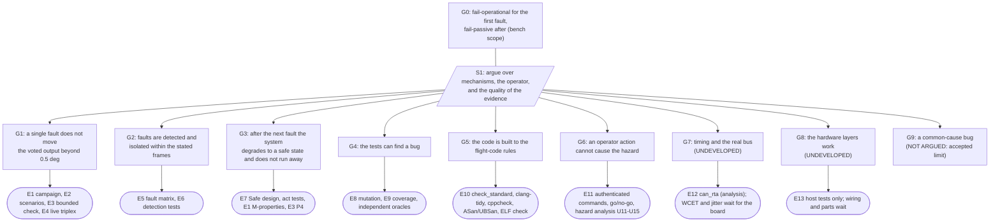

# Safety case: the argument that joins the evidence into one claim

> Status: **written** (18 Oct 2026; revised 19 Oct 2026). A structured argument (claims, strategy, evidence, assumptions, and what is **not** argued) in the manner of GSN (the Goal Structuring Notation: Kelly and Weaver, 2004, from memory). The project had the evidence, in many pages, and no page that said what the evidence adds up to or what it leaves out. This is that page. It is **one person's argument, reviewed by no one**, about a bench demonstrator; it is written so that a reader can attack it, and the most useful thing a reviewer can do with it is to find a claim that the evidence does not carry.

## 1. The top claim, and its context

**G0.** *The flight-computer design is **fail-operational** through sensing and computing for the first fault in a flight computer, an IMU or a computer's link to the bus, and **fail-passive** after the next unresolved fault, within the scope below, on the evidence available on 18 Oct 2026.* (`LIMITATIONS.md` 1; `TFC-SYS-006`; the words are those of `SAFE_MODE.md` 3.)

* **Scope (C1):** a bench demonstrator (three flight computers, ACT, a supervisor, a simulator, a servo platform). **Not** a flight system; no radiation, vibration or EMC environment (`LIMITATIONS.md` 2).
* **Assumptions:** A1 one fault at a time for the first-fault claim (the campaign samples pairs and cascades but the claim for two independent faults is "degrades as designed in the cases tried"); A2 the replicas fail independently (random hardware faults); a bug common to all three is **outside the claim** (A2'); A3 the shared bus, the actuator node, the supervisor and the single power adapter are single points and are outside it (`LIMITATIONS.md` 1); A4 the command key is the bench key.
* **Strategy (S1):** argue over the **mechanisms** (mask, detect, isolate, recover, degrade safely), over the **operator's part**, and over the **quality of the evidence** (can the tests find a bug, is the code built to the rules); and say what is **undeveloped**.

## 2. The evidence for each claim, and how far it goes

| Claim | Argument | Evidence (reproduce with) | Reaches |
|---|---|---|---|
| **G1** one fault does not reach the output | the 2-of-3 mid-value select masks one wrong value in the same frame, before any detection; ACT does the same on the command | **E1** the fault campaign: <!--m:campaign_scenarios-->12,362<!--/m--> scenarios, <!--m:campaign_frames_million-->4.9<!--/m--> million frames, **no safety property violated, no anomaly** (`cd sim && python3 -m campaign.run --strict`); **E2** `tests/test_triplex_scenarios.cpp` (stuck, bias step, dropout, wild values); **E3** the bounded check: every sequence of three phases, one computer wrong at a time, 17,576 sequences, 256,000 frames, while two computers vote the output stays within 2.5 of the truth (`tests/test_model_check.cpp`, P6); **E4** the live triplex on a virtual bus (`tools/bench/sil_triplex.sh --test`) | software-in-the-loop and live on a virtual bus; **not on a board** |
| **G2** detection and isolation | persistence 3 of 5, the digest, the stuck detector, the sequence check; detection times in frames | **E5** `FAULT_MATRIX.md` (every fault with its injected form, expected detection and test), **E6** the per-fault tests (`bias_step_isolated_in_exactly_m_frames` ...) and the campaign's measured latencies | SIL; the measured times on hardware are M4 |
| **G3** degrade safely | Triplex to Duplex to Simplex; an unattributable Duplex disagreement holds the last good value and requests Safe, sticky until an operator ends it; Safe freezes then nulls at a rate limit | **E7** `SAFE_MODE.md`, `ACT_LOGIC.md`; `tests/test_act.cpp`; the campaign's always-true properties M1 to M10 and S1 to S3; **E3** P4 (Safe once requested stays) | SIL; the servo's no-signal behaviour waits for P-M1-01 |
| **G4** the tests can find a bug | tests are shown able to fail | **E8** <!--m:mutants_unit-->469<!--/m--> deliberate bugs in the core and <!--m:mutants_sim-->494<!--/m--> in the simulator (the last full runs: <!--m:mutation_unit_result-->not yet recorded<!--/m--> and <!--m:mutation_sim_result-->not yet recorded<!--/m-->; the equivalent ones are listed with the reason); **E9** <!--m:coverage_core_line-->0<!--/m--> % of lines and <!--m:coverage_core_branch-->0<!--/m--> % of branches of `core/`, <!--m:coverage_sim_line-->0<!--/m--> % and <!--m:coverage_sim_branch-->0<!--/m--> % of the simulator; **E14** the second-reader review of the core (`CODE_REVIEW_CORE.md`): eight defects found, each fixed and pinned by a test and a mutant; the oracles of the campaign are independent of the code under test | mutation proves the tests catch the bugs that were injected, not all bugs; the headers that carry no mutant (the guidance, navigation and attitude control) are not covered by this claim (`STATUS.md` section 2) |
| **G5** built to the rules | JPL's ten rules, CERT and bugprone checks, no heap, a 2 KB stack bound | **E10** `tools/check_standard.py`, clang-tidy, cppcheck, ASan and UBSan, `tools/check_elf.sh` on the ARM image | mechanical; not DO-178C and not claimed to be |
| **G6** the operator | commands are authenticated, counted, ARM-protected; launch needs a four-condition go/no-go that is checked again every frame of the countdown | **E11** `ground_*`, `act_ground_*`, `tests/test_launch.cpp`, the console's go/no-go equals the checklist over 400 random states; `HAZARDS.md` U11 to U15 | host and live virtual; the key is the bench key (U16 is a **gap** for a real uplink) |
| **G7** timing, the real bus | the frame schedule is time-triggered with measured margins | **E12** `tools/bench/can_rta.py`: every frame meets its deadline in every jitter corner on the firmware's schedule, smallest slack 340 us (the analysis, `PROTOCOL.md`); **nothing is measured on a board**: the WCET of the step and the vote, the jitter, the real loss rate | **undeveloped**: waits for S1 (`STATUS.md` section 5, rows 1 to 3) |
| **G8** the hardware layers | the supervisor acts only on a node that has stopped; the overrides have priority and are fail-safe in their wiring | **E13** the supervisor's host tests (100 % of its lines) and the override logic; the lines, the relays and the override parts are **not wired or not ordered** | **undeveloped** |
| **G9** a bug common to all replicas | none by voting | node C on the previous release (ADR-021) protects against a regression, **not** against a bug in both releases | **not argued: an accepted limit** (`LIMITATIONS.md` 2) |

## 3. What would defeat the claim

A **defeater** is evidence that a claim is false. None found so far defeats G1 to G6 inside their scope. Two findings of 18 Oct 2026 reduce what G7 can be: the resync burst's margin (340 us, and **negative** once the mission's frames are sent: `PROTOCOL.md`), and the unknown cycle time of the guidance on the target (`RISKS.md` R2); a third, the bounded check, **first failed** on a sequence of two faults, which sharpened the statement of G1 (a lone survivor with a bias is the output: A1 is what the claim rests on). A fourth, on 19 Oct 2026, reduced G3 until it was fixed: the review of the core found that ACT kept its mode in a plain byte, so one upset could turn a Safe into a Standby and Safe could be left without the operator (`CODE_REVIEW_CORE.md` finding 2); ACT now guards it. The FMECA (`FMECA.md`) lists the single points and the critical items that nothing yet exercises. A reader who finds a sequence of one fault that moves the output more than 0.5 degree has defeated G1; the campaign and the bounded check are where to look.

## 4. The confidence statement

G1 to G6 are supported by evidence that is automated, reproducible and (G4) shown able to fail; they are **simulation evidence**. G7 and G8 are open and are the ones that turn "demonstrated in simulation" into "demonstrated". G9 is excluded. **The claim as a whole is demonstrated in simulation and on a virtual bus, and not on hardware.** What changes that is `STATUS.md` section 5 (the board), and the first thing to do after it is to re-read this page and move G7 and G8 from "undeveloped" to a measured row.
